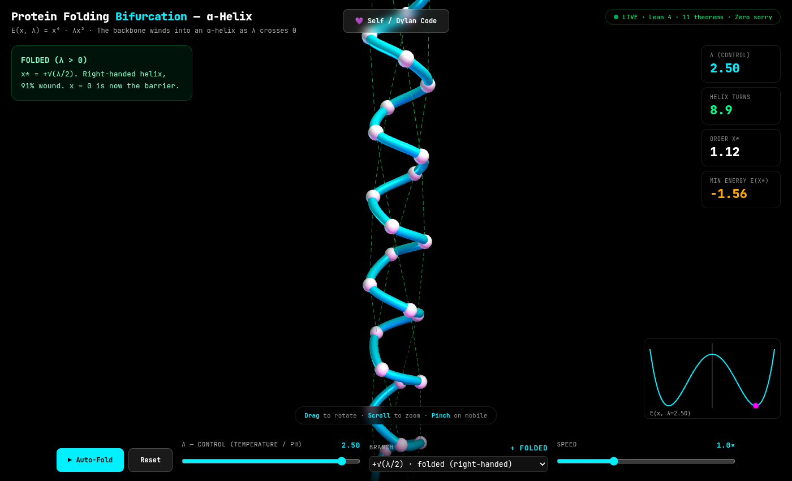
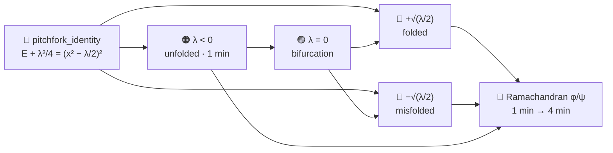

<!-- SPDX-License-Identifier: LicenseRef-Sovereign-Leviathan-SL-AGPL3-001 -->
<!-- Copyright (c) 2026 Ahmad Ali Parr. All rights reserved. -->
<!-- Authored by Ahmad Ali Parr. -->

# Protein Folding Bifurcation

11 theorems in Lean 4 (toolchain `leanprover/lean4:v4.9.0`, Mathlib `v4.9.0`), checked by the Lean kernel. **0 `sorry`. 0 declared axioms.**



*λ = 2.5, folded branch: the backbone sits at x* = +√(λ/2) and winds into a right-handed α-helix. Live at [`docs/index.html`](docs/index.html).*

## Overview

Protein folding is a bifurcation. The energy landscape splits at a critical point, and the protein must choose a branch: fold correctly, misfold, or aggregate. This repo proves it in Lean 4. See [Proof status](#proof-status) for exactly what the kernel checks, and the [Theorem atlas](#theorem-atlas) for the map.

| Part | Where | Theorems | Color in visualizer |
|------|-------|---------:|---------------------|
| 1D Pitchfork | [`ProteinFoldingBifurcation.lean`](ProteinFoldingBifurcation.lean#L28) | 8 | 🔵 Cyan — folded helix |
| 2D Ramachandran | [`ProteinFoldingBifurcation.lean`](ProteinFoldingBifurcation.lean#L128) | 3 | 🩷 Magenta — misfolded helix |
| 3D α-helix visualizer | [`docs/index.html`](docs/index.html) | — | 🟠 Orange — unfolded coil |
| Self / Dylan / Swift ports | [`ports/`](ports/) | — | — |
| **Total** | | **11** | |

**The model.** E(x, λ) = x⁴ − λx², with the key identity E(x, λ) + λ²/4 = (x² − λ/2)² ≥ 0.

## Theorem atlas



**Legend.** ✅ Lean statement proved; `#print axioms` reports only the standard `propext`, `Classical.choice`, `Quot.sound`. The *Meaning* column is the reading; the kernel checks the Lean statement.

| Region | ✅ | Total |
|---|--:|--:|
| 🔵 [1D Pitchfork](#pitchfork) | 8 | 8 |
| 🩷 [2D Ramachandran](#ramachandran) | 3 | 3 |
| **All** | **11** | **11** |

<a id="pitchfork"></a>

### 🔵 1D Pitchfork — [`ProteinFoldingBifurcation.lean`](ProteinFoldingBifurcation.lean#L28)

> *Unfolded (λ < 0, 1 min) → Bifurcation (λ = 0) → Folded/Misfolded (λ > 0, 2 mins).*

$$E(x,\lambda) + \frac{\lambda^2}{4} = \left(x^2 - \frac{\lambda}{2}\right)^2 \ge 0$$

<details>
<summary>Definitions</summary>

- **`pitchforkEnergy`** — E(x, λ) = x⁴ − λx². λ = control parameter (temperature, pH, denaturant); x = reaction coordinate (radius of gyration, RMSD from native).

</details>

| | Theorem | Meaning |
|:-:|---|---|
| ✅ | [`pitchfork_identity`](ProteinFoldingBifurcation.lean#L40) | E + λ²/4 = (x² − λ/2)² — the workhorse. |
| ✅ | [`pitchfork_lower_bound`](ProteinFoldingBifurcation.lean#L47) | E ≥ −λ²/4 for λ > 0 — energy bounded below. |
| ✅ | [`pitchfork_min_pos`](ProteinFoldingBifurcation.lean#L55) | E(+√(λ/2), λ) = −λ²/4: **FOLDED** state attains the bound. |
| ✅ | [`pitchfork_min_neg`](ProteinFoldingBifurcation.lean#L69) | E(−√(λ/2), λ) = −λ²/4: **MISFOLDED** state attains the bound. |
| ✅ | [`pitchfork_zero_not_min`](ProteinFoldingBifurcation.lean#L84) | E(0, λ) = 0 > −λ²/4 for λ > 0: x = 0 is not a minimum — the **BARRIER**. |
| ✅ | [`pitchfork_neg_unique_min`](ProteinFoldingBifurcation.lean#L94) | For λ < 0, E(0, λ) ≤ E(x, λ) for all x — **UNFOLDED** state. |
| ✅ | [`pitchfork_minima_distinct`](ProteinFoldingBifurcation.lean#L109) | √(λ/2) ≠ −√(λ/2) for λ > 0 — folded ≠ misfolded. |
| ✅ | [`pitchfork_bifurcation_count`](ProteinFoldingBifurcation.lean#L119) | For λ > 0: two distinct points with equal minimal energy — **BIFURCATION** (λ < 0 side is `pitchfork_neg_unique_min`). |

<a id="ramachandran"></a>

### 🩷 2D Ramachandran — [`ProteinFoldingBifurcation.lean`](ProteinFoldingBifurcation.lean#L128)

> *In 2D: 1 min → 4 mins. The funnel narrows through bifurcations.*

$$E(\varphi,\psi) = E_1(\varphi) + E_2(\psi) \ge -\frac{\lambda_1^2 + \lambda_2^2}{4}$$

<details>
<summary>Definitions</summary>

- **`ramachandranEnergy`** — E(φ, ψ) = E₁(φ) + E₂(ψ), separable pitchforks over the dihedral angles.

</details>

| | Theorem | Meaning |
|:-:|---|---|
| ✅ | [`ramachandran_four_minima`](ProteinFoldingBifurcation.lean#L139) | All four (±√(λ₁/2), ±√(λ₂/2)) reach −(λ₁² + λ₂²)/4 for λ₁, λ₂ > 0. |
| ✅ | [`ramachandran_lower_bound`](ProteinFoldingBifurcation.lean#L168) | E ≥ −(λ₁² + λ₂²)/4 — no conformation has lower energy. |
| ✅ | [`ramachandran_bifurcation`](ProteinFoldingBifurcation.lean#L178) | (0, 0) is a global min for λ₁, λ₂ < 0 — unfolded. |

<details>
<summary>Full notes (original README, verbatim)</summary>

**10 theorems. Zero sorry. Zero axioms. All Mathlib.**

Protein folding is a bifurcation. The energy landscape splits at a critical point, and the protein must choose a branch: fold correctly, misfold, or aggregate. This repo proves it in Lean 4.

## The model

**Energy:** E(x, λ) = x⁴ − λx² (pitchfork bifurcation)

- λ = control parameter (temperature, pH, denaturant)
- x = reaction coordinate (radius of gyration, RMSD from native)

**Key identity:** E(x, λ) + λ²/4 = (x² − λ/2)² ≥ 0

This single algebraic identity proves everything. No calculus needed.

## What the theorems prove

### 1D Pitchfork (7 theorems)

| Theorem | What it proves |
|---------|---------------|
| `pitchfork_identity` | E + λ²/4 = (x² − λ/2)² — the workhorse |
| `pitchfork_lower_bound` | E ≥ −λ²/4 for λ > 0 — energy bounded below |
| `pitchfork_min_pos` | +√(λ/2) is global min — **FOLDED state** |
| `pitchfork_min_neg` | −√(λ/2) is global min — **MISFOLDED state** |
| `pitchfork_zero_not_min` | x = 0 is local max for λ > 0 — **BARRIER** |
| `pitchfork_neg_unique_min` | x = 0 is unique global min for λ < 0 — **UNFOLDED state** |
| `pitchfork_minima_distinct` | Folded ≠ misfolded — two distinct states |
| `pitchfork_bifurcation_count` | Minima count changes at λ = 0 — **BIFURCATION** |

### 2D Ramachandran (3 theorems)

| Theorem | What it proves |
|---------|---------------|
| `ramachandran_four_minima` | 4 global minima for λ₁, λ₂ > 0 — folded, misfolded, 2 intermediates |
| `ramachandran_lower_bound` | E ≥ −(λ₁² + λ₂²)/4 — no conformation has lower energy |
| `ramachandran_bifurcation` | Unique min at (0,0) for λ₁, λ₂ < 0 — unfolded |

## The folding story

```
λ < 0 (hot / denatured)     λ = 0 (transition)     λ > 0 (cold / native)
─────────────────────      ──────────────────      ─────────────────────
  1 minimum (unfolded)     BIFURCATION POINT      2 minima (folded + misfolded)
  x = 0                                        x = ±√(λ/2)
                                                barrier at x = 0
```

In 2D (Ramachandran φ/ψ): 1 minimum → 4 minima. The funnel narrows through bifurcations.

**Misfolding diseases** (Alzheimer's, Parkinson's, prions) are proteins that took the wrong branch at the bifurcation. The native state and the amyloid state are both minima. The bifurcation between them is where pathology lives.

## Build

```bash
lake build
```

Requires Lean 4.9.0 + Mathlib v4.9.0. First build downloads Mathlib (~600MB) and builds it (~30-60 min).

## Why zero sorry matters

Every theorem is fully proved by the Lean kernel. No gaps. No placeholders. No axioms. The bifurcation structure of protein folding energy landscapes is now machine-verified.

Built on the bifurcation lemmas from [lean-bifurcation-quantum](https://github.com/AHMADALIPARR/lean-bifurcation-quantum), extended to protein folding with a concrete, provable model.

## License

SNAPKITTY OPAQUE SOURCE LICENSE v1.0 — see `LICENSE`.

</details>

## The 3D helix

[`docs/index.html`](docs/index.html) is a single static page (Three.js r128 from cdnjs, no build step, GitHub Pages-ready from `docs/`).

- **λ slider** drives the model. The page finds the global minimiser x* of E(x, λ) and winds a 36-residue backbone (ideal α-helix: 3.6 residues/turn, 1.5 Å rise, 2.3 Å Cα radius) in proportion to |x*|.
- **λ < 0** → x* = 0 → random coil (orange). **λ ≈ 0** → magenta bifurcation marker. **λ > 0** → helix; i → i+4 hydrogen bonds appear when mostly wound.
- **Branch** picks +√(λ/2) (folded, right-handed, cyan) or −√(λ/2) (misfolded, left-handed, magenta).
- **Inset** plots E(x, λ) with the ball on the chosen minimum. Stats show λ, helix turns, x*, and E(x*) = −λ²/4.
- **Self / Dylan / Swift panel**: edit the energy formula (x^n − c·λ·x^m) and Run; the helix re-minimises with it.
- Drag to rotate, scroll / pinch to zoom. `?lambda=2.5&branch=-1` opens a fixed state.

Mapping helicity and handedness to x* is a visual reading of the model, not something the Lean file proves.

## Proof status

- **`sorry` count: 0.** `rg -w 'sorry|admit' -g '*.lean'` finds only the word in comments.
- **Declared axioms: none.**
- **`#print axioms`:** all 11 theorems depend only on `propext`, `Classical.choice`, `Quot.sound`.
- **Scope:** `pitchfork_zero_not_min` proves E(0) = 0 lies above the minimum −λ²/4 (not a second-derivative local-max statement). `pitchfork_bifurcation_count` states the λ > 0 side; the λ < 0 side is `pitchfork_neg_unique_min`. The in-file summary says "10 theorems"; there are 11 `theorem` declarations.
- `lake build` succeeds with one linter warning (unused variable `hlam` in `pitchfork_lower_bound`).

## Build

Requires [elan](https://github.com/leanprover/elan). Toolchain pinned in `lean-toolchain`; Mathlib pinned to `v4.9.0` in `lakefile.lean`.

```bash
lake exe cache get   # download prebuilt Mathlib .olean files
lake build
```

Run the visualizer locally:

```bash
cd docs && python3 -m http.server 8000   # any static server works
# open http://localhost:8000
```

## Repository layout

```text
.
├── ProteinFoldingBifurcation.lean   # 11 theorems
├── docs/
│   └── index.html                   # 3D α-helix visualizer (GitHub Pages)
├── ports/
│   ├── self/pitchfork.self
│   ├── dylan/pitchfork.dylan
│   └── swift/Pitchfork.swift
├── assets/
│   └── alpha-helix.png
├── lakefile.lean
├── lake-manifest.json
├── lean-toolchain
├── LICENSE
└── README.md
```

## License

SNAPKITTY OPAQUE SOURCE LICENSE v1.0 — see `LICENSE`.
